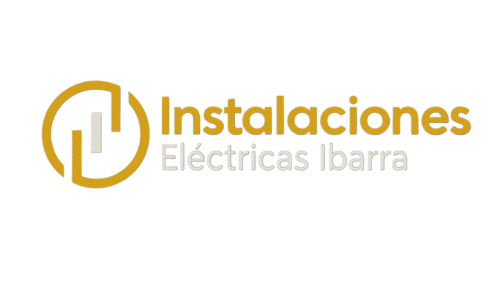

---

 

  

  Instalaciones · Reparaciones · Mantenimiento

Servicio profesional de electricista en Zaragoza y alrededores,
especializado en instalaciones eléctricas, averías y mantenimiento.

---
---

## ⚡ Servicios

<ul style="
  list-style:none;
  padding-left:0;
  margin:0;
  font-size:0.95em;
">

  <li style="white-space:nowrap; overflow:hidden; text-overflow:ellipsis;">
    ⚡ Instalaciones eléctricas en viviendas
  </li>
  <li style="white-space:nowrap; overflow:hidden; text-overflow:ellipsis;">
    ⚡ Instalaciones industriales y comerciales
  </li>
  <li style="white-space:nowrap; overflow:hidden; text-overflow:ellipsis;">
    ⚡ Cuadros eléctricos
  </li>
  <li style="white-space:nowrap; overflow:hidden; text-overflow:ellipsis;">
    ⚡ Iluminación interior y exterior
  </li>
  <li style="white-space:nowrap; overflow:hidden; text-overflow:ellipsis;">
    ⚡ Mantenimiento y averías
  </li>
  <li style="white-space:nowrap; overflow:hidden; text-overflow:ellipsis;">
    ⚡ Boletines eléctricos
  </li>
  <li style="white-space:nowrap; overflow:hidden; text-overflow:ellipsis;">
    ⚡ Adaptación a normativa (REBT)
  </li>

</ul>

---
---

## 📍 Zona de trabajo

<strong>Zaragoza ciudad y alrededores</strong> 
Servicio rápido, cercano y adaptado a normativa.

## 📝 Solicitar presupuesto / Aviso

  <form action="https://formspree.io/f/xnjjjlnj"
      method="POST"
      style="
        background:#141414;
        padding:20px;
        border-radius:10px;
        margin-top:20px;
        display:grid;
        gap:14px;
      ">
      
  <input type="hidden" name="_subject" value="Nuevo aviso desde la web - Instalaciones Eléctricas Ibarra">
  <input type="hidden" name="_next" value="https://instalacioneselectricasibarra.es/?enviado=ok">

  <!-- Tipo -->
<select name="tipo" required
  style="
    width:100%;
    padding:12px 40px 12px 12px;
    border-radius:6px;
    background:#1b1b1b;
    color:#f2f2f2;
    border:1px solid #f5a623;
    appearance:none;
    -webkit-appearance:none;
    -moz-appearance:none;
    background-image:url('data:image/svg+xml;utf8,
      <svg xmlns=&quot;http://www.w3.org/2000/svg&quot; viewBox=&quot;0 0 24 24&quot; fill=&quot;%23f5a623&quot;>
        <path d=&quot;M7 10l5 5 5-5z&quot;/>
      </svg>');
    background-repeat:no-repeat;
    background-position:right 12px center;
    background-size:18px;
  ">
    <option value="" disabled selected>Tipo de servicio</option>
    <option>Instalación</option>
    <option>Avería</option>
    <option>Mantenimiento</option>
  </select>

  <!-- Zona -->
  <input name="zona" required
    placeholder="Zona / Calle"
    style="
      width:100%;
      padding:12px;
      border-radius:6px;
      background:#1b1b1b;
      color:#f2f2f2;
      border:1px solid #f5a623;
    ">

  <!-- Teléfono -->
  <input name="telefono" inputmode="tel"
    placeholder="Teléfono"
    style="
      width:100%;
      padding:12px;
      border-radius:6px;
      background:#1b1b1b;
      color:#f2f2f2;
      border:1px solid #f5a623;
    ">

  <!-- Descripción -->
  <textarea name="descripcion" rows="4" required
    placeholder="Describe el trabajo o la avería"
    style="
      width:100%;
      padding:12px;
      border-radius:6px;
      background:#1b1b1b;
      color:#f2f2f2;
      border:1px solid #f5a623;
      resize:vertical;
    "></textarea>

  <!-- Botón -->
  <button type="submit"
    style="
      background:#f5a623;
      color:#000;
      font-weight:700;
      border:none;
      border-radius:30px;
      padding:12px;
      cursor:pointer;
    ">
    Enviar solicitud
  </button>

</form>

## 📞 Contacto

<a href="https://wa.me/34658377727"
   style="
     display:block;
     margin-bottom:12px;
     font-size:1.05em;
     color:#f5a623;
     text-decoration:none;
     font-weight:600;
   ">
  📲 WhatsApp: 658 377 727
</a>

<a href="mailto:instalacioneselectricasibarra@gmail.com"
   style="
     display:block;
     font-size:1em;
     color:#f5a623;
     text-decoration:none;
   ">
  📧 maielectricidad@hotmail.com
</a>

[Política de Cookies](/cookies) · 
[Política de Privacidad](/privacidad) · 
[Aviso Legal](/aviso-legal)

